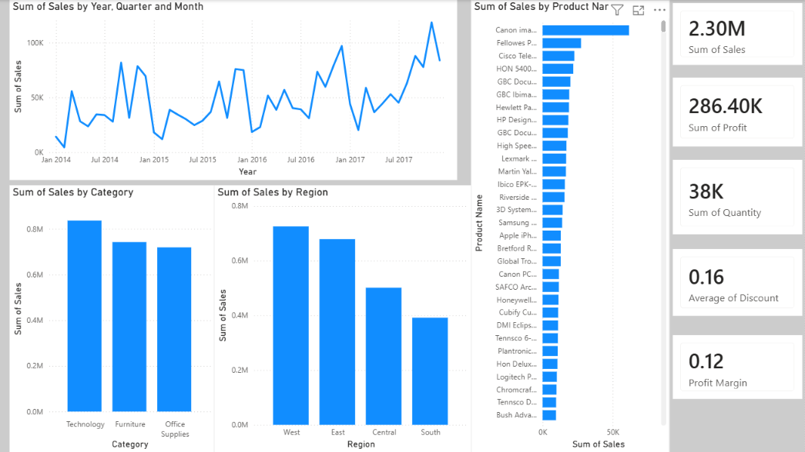

# Superstore Sales Analysis - Alfido Tech Task

## What is this project about?
I made this project for my Alfido Tech internship task. The goal is to look at a retail Superstore dataset and find out how the business is doing. I loaded the raw data into Power BI, cleaned and transformed it using Power Query, and built an interactive dashboard to see when sales go up, which regions buy the most, and how we can help the store make more money.

---

## The Big Numbers (KPIs)
Here is a quick look at the store's total performance:
* **Total Sales:** 2.30M
* **Total Profit:** 286.40K
* **Profit Margin:** 12.00% 
* **Items Sold:** 38K
* **Average Discount:** 16%

---

## What did I find in the data? (Key Insights)
* **Holiday Rush:** Every single year, sales jump up massively between October and December (Q4). The holiday season is the busiest time for the store.
* **Region Differences:** The West and East regions are doing amazing and bring in most of the money. However, the South region is lagging far behind.
* **What Sells More?:** Tech products make the most money, while basic Office Supplies are at the bottom.
* **Star Product:** Canon products and imaging gear are incredibly popular and causing massive sales spikes compared to everything else.

---

## 5 Practical Ideas to Improve Sales (Tactical Improvements)

After looking at my Power BI dashboard, here are 5 simple and realistic things the store can do to grow:

1. **Prepare early for the winter rush:** Since sales always skyrocket from October to December, the store should stock up on popular items and hire extra warehouse hands by late September so they never run out of stock.
2. **Fix the South region:** Since the South has the lowest sales, the store should spend some marketing budget there, run local ads, or offer special regional deals to attract more customers.
3. **Mix popular tech with slow items:** We can create combo offers. For example, give a small discount on printer paper or office folders when someone buys a high-end printer or laptop. This helps clear slow stock and increases the total bill value.
4. **Get a better deal from Canon:** Canon products are our absolute best-sellers. The store management should talk directly to the manufacturers to get a wholesale discount. Lower buying costs mean more profit for us.
5. **Control the discounts:** Right now, the average discount is quite high at 16%. Giving away too many discounts eats into our profit margin. We should limit high discounts and instead give customers loyalty points that bring them back to shop again.

---

## Files in this Repository
* `superstore sales analysis.pbix` - My interactive Power BI dashboard file (contains all data cleaning, transformations, and visuals).
